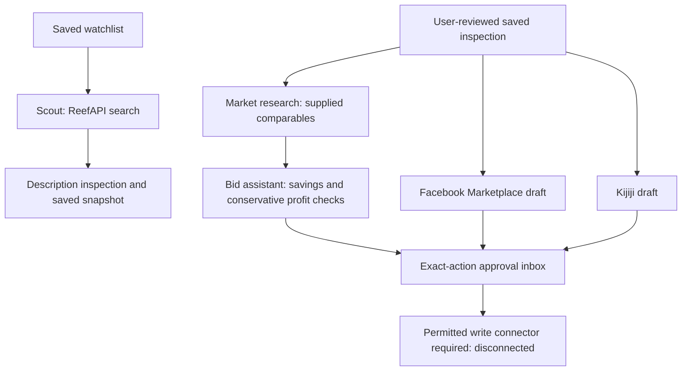

# HiBid Smart Deal Hunter

A private Canadian auction catalogue and inspection dashboard with optional ReefAPI live listing search. It stores watchlists and inspection history, identifies condition concerns, compares retail evidence, and calculates a hammer-bid ceiling for **at least 70% all-in savings**. It never logs in to HiBid or runs a HiBid scraper. User-queued scout jobs retrieve auction data through ReefAPI. There is no live bid submission or marketplace publishing connector installed; approvals and ad drafts stay private proposals.

## Run locally

Python 3.10+ is required (validated with Python 3.12).

```sh
python -m venv .venv
. .venv/bin/activate
pip install -r requirements.txt
python -m dealhunter.security
```

The last command asks for a **new application password**, then prints its salted PBKDF2-SHA256 hash (600,000 rounds). Do not reuse a HiBid password. Configure accounts using environment variables or an ignored `.streamlit/secrets.toml`:

```toml
DEAL_HUNTER_USERS = '{"alice":"<generated hash>","bob":"<another generated hash>"}'
# Optional: only configure DEAL_HUNTER_DB if you have an actual writable volume.
# Otherwise omit it and use the default user storage directory.
```

Then run:

```sh
streamlit run app.py --server.address=127.0.0.1 --server.headless=true --browser.gatherUsageStats=false
```

No accounts configured means the application stays locked and does not open the private database. Each configured username owns its own watchlists, history, photos and decisions. Use a unique account per person. Sign out clears session state; idle sessions expire after 30 minutes on the next interaction. Changing/removing an account hash revokes its active sessions on their next interaction. The in-process login limiter permits five attempts per username per minute and 100 total attempts per minute. Multiple app processes require a shared authentication gateway/rate limiter. Use HTTPS and access controls before exposing this application remotely; do not expose a development server directly to the Internet. Android users can open the authenticated HTTPS dashboard in their browser; columns stack on narrow screens, sidebar settings remain available, and actions have touch-sized controls.

## Workflow

The **Catalogue** tab supports **Live HiBid listings**, **Saved inspections**, and **Saved auction snapshots**. With a configured ReefAPI key, live listings are the default source. Search is optional: browse Canadian lots by postcode, radius, province and real provider category IDs without entering a specific model. Without a key, saved inspections are the default; the live source displays configuration guidance.

Saved inspection cards contain photos, descriptions, conditions, retail evidence, proposed bid, all-in costs, savings, bid ceiling, findings and decisions. Saved auction snapshots contain provider data and its original fetch time, never a current-bid guarantee. An exact model is needed when inspecting a particular item for a reliable retail comparison, not for browsing. Saved inspections show the latest snapshot per listing URL within the latest 200 inspections. API results and saved inspection cards display ten cards per display page; API page requests are separate from display pagination. Catalogue cards update after saves.

1. Save named watchlists with multiple categories, brands, exact models, keywords and acceptable conditions. Brand/model filters match any saved value; keywords match any saved phrase; the groups combine with AND. Search auctions yourself within the saved postal centre and pickup radius.
2. Paste a listing URL, exact model and full seller description. Select all claimed conditions. Upload up to five PNG/JPEG/WebP photos (10 MB and 20 megapixels each). Description rules flag damage, missing accessories, uncertainty and conflicting sealed claims; they are conservative signals, not factual findings. Review the photos and record visible damage, missing accessories, inconsistent claims and notes. Review selections reset when the photo evidence, description or conditions change.
3. Enter a comparable Canadian retailer's exact model, equivalent condition, availability, price in CAD, URL and delivery cost. A manual price is labelled **unverified** until you explicitly attest to the source checks. A manually verified price stays labelled **manual**, never **live**. Attestation resets when its product, claims, source or amount changes. Alternatively use the optional authorized retail API below. Add verified sources to the comparison; the lowest delivered comparable price is selected. Clear comparison sources to remove old evidence. Saved manual checks remain historical evidence and need rechecking by the user; live observations expire after 15 minutes. Comparison lists are scoped to the listing/model/conditions and included in the saved inspection.
4. Enter buyer premium, separate retail/auction tax rates, shipping/pickup and all mandatory fixed fees. Choose whether premium, shipping and fees are taxable. Enter the proposed hammer bid and auction bid increment. Retail delivery is entered tax-inclusive. No distance, stock, seller tax treatment or bid ladder is automatically verified: complete the manual checklist.
5. Read the **eligible**, **requiring review**, or **rejected** decision. Eligibility requires a verified comparable source, matching watchlist, completed manual checklist, reviewed photos, an acceptable condition, no flagged concerns, and a feasible bid meeting the savings rule. Missing evidence and uncertainty require review; unacceptable conditions, infeasible budgets and unapproved over-ceiling bids are rejected.
6. To exceed the ceiling, enter a reason, check the confirmation for the specific bid and click **Approve this exception and save inspection**. The approval stores its user, time and the SHA-256 scope of the exact record including photo hashes. Changed inputs require another confirmation and explicit save; approvals are never carried forward. An approved exception remains **requiring review** and never submits a bid. Bids exceeding the all-in budget fail the discount rule; a fractional bid above the rounded increment ceiling also needs approval even if it fits the budget. Unacceptable watchlist conditions and infeasible budgets cannot be overridden.
7. Save inspection snapshots and view your private history. Listing details, watchlist preferences, assessments, selected/all comparable sources, tax assumptions, calculations, photos and decisions persist in SQLite. History displays the latest 200 records; older records remain stored. JSON exports include photo filenames/hashes, not photo bytes. Photos and exports are embedded in the authenticated session instead of public Streamlit media endpoints.

Photos cannot establish functionality, hidden defects, authenticity or factory sealing. An eligible decision is not a guarantee and is not authorization to bid. Check auction terms and place any bid yourself on HiBid.

## Calculation

With auction tax `t` and premium rate `p`, the hammer multiplier is `1 + t + p × (1 + t)` when premium is taxable, or `1 + t + p` otherwise. Fixed shipping and mandatory fees each receive tax only if marked taxable. Retail delivered total is `retail × (1 + retail tax) + tax-inclusive delivery`. The allowed auction budget is `retail delivered total × (1 − savings target)`. Subtract fixed costs, divide by the hammer multiplier, then floor using Decimal arithmetic to the selected bid increment. If fixed costs exceed the budget or retail is zero, there is no feasible qualifying bid (a displayed zero ceiling does not imply eligibility). Default CAD $100 retail, 13% taxes, 15% taxable premium and no fees yields a $26 hammer ceiling. Increment multiples may differ from the auction's actual bid ladder. Percentage surcharges beyond the buyer premium, tiered taxes and unusual tax treatment need separate calculation.

## ReefAPI live auction catalogue

Create a ReefAPI key at https://reefapi.com/signup and add it securely to your hosting environment or ignored `.streamlit/secrets.toml`:

```toml
REEFAPI_KEY = "<your ReefAPI key; never commit or paste it into chat>"
```

The application calls `POST https://api.reefapi.com/hibid/v1/search`, `/detail`, and `/categories` with an `x-api-key` header. It does not use the credential-in-URL MCP option and does not require a HiBid username or password. This is a **third-party provider**, not an official HiBid integration. Ensure your provider account and intended use are authorized. Allow `api.reefapi.com` outbound on the hosting platform. Public listing image URLs load directly in your browser without the API key and with no referrer. API access does not itself prove that every Canadian auction or retailer is covered.

1. Choose **Live HiBid listings**, optionally enter keywords, and choose postcode/radius/province, auction status, order and API page. Canada is always sent as the country. Radius is converted from km to whole miles, rounded down with a minimum of one mile; postcode proximity and auction-house location do not verify actual pickup distance. Confirm pickup location manually.
2. Optionally click **Load HiBid categories** and select up to five real provider category IDs. The manual watchlist's category labels are not guessed into provider IDs. Each selected category makes a separate search call; repeated lot IDs are deduplicated. Sorting/page numbers apply to each category request, not a universal combined ranking.
3. Click **Search / refresh current listings**. No specific model is required, and normal rerenders, display paging and unrelated actions do not make API calls. Cards show title, public photo, current bid, next required bid, currency, bid count, closing time, sale, auction house, location and link, with all returned data available in the details expander. The number shown is the actual reported bid, not a proposed or invented bid.
4. Click **Fetch full lot details** for all pictures, category path, complete sale terms and increments. The client sends `include_bids=false`, so the public bidder ladder is not requested. A mismatched returned lot ID is rejected. Search and detail responses must have `ok=true`; HTTP failures, malformed responses and oversized data are errors rather than empty or fabricated results.
5. Click **Save auction snapshot** to persist the sanitized provider record privately. Choose **Saved auction snapshots** to view it without an API request. This snapshot is not an inspection decision or bid approval. Provider credentials and response credential fields are stripped, and request headers are not saved.
6. Click **Inspect this lot**, then open the **Inspect listing** tab. This imports title, description, auction metadata and the reported next bid (or current bid if next bid is unavailable); unknown bids default to an editable proposal of zero, not a claimed live bid. Verify the actual model, condition and costs. Natural-language or tiered premiums/taxes are preserved as terms and never silently parsed into assumptions. Conditions and verification checkboxes reset. Public images support manual inspection but their bytes are not archived: upload files for AI analysis and immutable photo storage. USD/unknown-currency and reported-closed lots cannot be imported into the CAD calculator. Below-minimum proposed bids are rejected using the reported next-bid amount. Inspectors still need verified comparable retail evidence before there is a meaningful 70% ceiling.

The supplied provider documentation lists **1 credit per search/category/detail call**. A multi-category search spends one call per category; there are no automatic retries or continuous refreshes. A partial multi-category failure may have spent credits on preceding successful calls. Actual usage is governed by your provider account; returned credit reports are displayed. Changing filters hides old results until the new search is requested. Refresh clears detail caches; results older than five minutes show a stale warning. Bids and soft-close times can change immediately after any fetch, so review the auction manually before bidding.

This integration is implemented against the user-supplied ReefAPI documentation. Its offline tests and browser checks use representative contract fixtures; they do not prove live provider availability, accuracy, image shape or pricing. Actual end-to-end provider validation requires a configured key and reachable API. The development environment currently reports a proxy CONNECT 403 to the provider; that restriction is separate from the hosted app's network settings. No fixture results are supplied by the production app.

## Optional photo analysis

```toml
VISION_API_KEY = "<enter securely; never commit>"
VISION_MODEL = "gpt-4.1-mini"
```

Clicking **Analyze photos** additionally requires explicit consent to send the photos and seller claims to OpenAI's HTTPS Chat Completions API (`api.openai.com`). Images are downscaled and metadata stripped before transmission. Results are labelled unverified AI observations; any finding requires manual review. No functionality inference is accepted. Invalid responses/failures do not yield a verified assessment, and stale results are invalidated when evidence changes. API usage may incur costs and is subject to provider data policies. Without a key, manual inspection remains available. Keys are read only from environment/secrets, never persisted with inspection records.

## Optional live Canadian retail verification

No retailer scraping is included. A deployment administrator can configure an **authorized retailer API adapter** using `RETAIL_API_URL` (HTTPS, trusted endpoint) and optional `RETAIL_API_KEY`. Use only endpoints the administrator trusts and is authorized to call; end users cannot supply request destinations. Redirects are disabled and TLS verification stays enabled. The adapter is responsible for authoritative retail evidence and must not fabricate observations. The request is a POST with this JSON:

```json
{"model":"ABC123","condition":"Like new","country":"CA","currency":"CAD"}
```

The optional key is sent as a Bearer header. A successful response must contain:

```json
{
  "model": "ABC123", "condition": "Like new", "country": "CA", "currency": "CAD",
  "in_stock": true, "price": 199.99, "delivery": 0,
  "url": "https://authorized-retailer.example/product/ABC123",
  "retailer": "Canadian retailer", "observed_at": "2026-10-14T16:00:00Z"
}
```

Use the actual observation time with a timezone (the example expires). `price` is before tax and `delivery` is tax-inclusive CAD. Exact model/condition, CA, CAD, in-stock status, positive finite price, nonnegative delivery and observation age under 15 minutes are enforced before assigning **live verified**. This verifies the adapter's current observation, not all Canadian retailers or a universal lowest price. No adapter/key is bundled and external providers are not needed for the manual workflow. Allow the adapter's hostname in deployment networking; keep its credentials out of URLs, logs and source files.

## Data and security

New installs default to `~/.local/share/hibid-smart-deal-hunter/dealhunter.sqlite3`, outside the source checkout, with owner-only file permissions. Existing checkout-local `data/dealhunter.sqlite3` history is reused when no override is configured; it is never silently moved or replaced. `DEAL_HUNTER_DB` overrides this with a real writable database file path (not just a directory). Invalid or inaccessible configured paths stop the private dashboard with a configuration message rather than silently creating another database.

On **Streamlit Community Cloud**, open **Manage app → Settings → Secrets** and omit `DEAL_HUNTER_DB` to use user storage. If you copied the old example `/private/persistent/dealhunter.sqlite3`, remove that line: the example did not create a volume and can cause `PermissionError`. Save the secrets and reboot the app if necessary. If that path previously contained records on another deployment, preserve/export them before changing it. Community Cloud local files are ephemeral and may disappear on reboot/redeployment; the writable default fixes startup, not durable hosting. For durable hosted history, use a host with an actual private persistent volume and configure its database file path. Never point private storage at a publicly served directory.

Delete the entire `DEAL_HUNTER_DB` setting to choose the default: `DEAL_HUNTER_DB = ""` is invalid. A hosting environment variable takes priority over Streamlit Secrets, so changing only Secrets does not override it. Startup diagnostics show the setting source, failed initialization stage and a safe error category (permission denial, read-only filesystem/database, invalid path, storage full, or database availability) without exposing paths or raw exceptions. `protect-database` means the host refused owner-only file permissions; it is not necessarily a missing directory. Existing history is never silently replaced.

If storage is unavailable, an authenticated user can explicitly acknowledge the risk and choose **Use temporary storage for this session**. This creates a separate private directory, never overwrites the configured database, and keeps a visible temporary-storage warning. Existing history is not shown. It is a recovery tool for inspection, not persistent storage: export records before signing out, and expect loss of access on logout or loss of files on reboot/redeployment. Without acknowledgement, the dashboard stays stopped.

Back up the database consistently (SQLite backup API or stop the app before copying). The database is not encrypted at rest: host filesystem access is an administrator privilege. There is no HiBid account/password field and no credential database. Uploaded files are validated as images and never executed. User data is scoped with parameterized queries; no private records are accessed before authentication. User-supplied HTML is not rendered. Do not commit `.streamlit/secrets.toml`, database files or keys. Internet-facing deployments should additionally use an authenticated HTTPS gateway for every path, especially with multiple worker processes.

## Tests

```sh
python -m pytest -q
python -m pip check
```

Tests exercise tax combinations and the 70% boundary, invalid inputs, impossible budgets, description conflicts, photo uncertainty, tenant isolation, persistence, password verification, login/logout, watchlist saving, manual verification resets, multiple retail comparisons, and snapshot-bound ceiling approvals. API tests mock provider responses and enforce source matching/freshness, safe redirects and photo response schemas. Streamlit AppTest runs the actual dashboard; uploaded image bytes are injected for the photo workflow. Live ReefAPI, paid photo analysis and retailer calls require credentials/network access and are not exercised by the offline suite. ReefAPI tests cover the documented request/envelope contract, header-only authentication, error handling, multicategory deduplication, detail identity, snapshot isolation and dashboard import guards. A separate headless mobile Chromium check at a 393-pixel viewport verified login, actual photo upload, approval gating/saving, stacked columns, no horizontal overflow, and no private media endpoint requests. Physical Android browser testing remains recommended before remote deployment. Audit timestamps are stored in UTC; dashboard timestamps display in America/Toronto.


## Agent team and phone inbox

The **Agent team** tab runs five specialist tool agents through persistent, owner-scoped jobs. These are explicit workflows with bounded tools, not unsupervised browser agents. Existing catalogue and inspection flows remain available.



1. Save a watchlist. Choose its real ReefAPI category IDs and queue a scout; saved category names alone are not sufficient. The scout searches up to three saved models, otherwise brands, otherwise keywords, and filters these groups against title/description. It caps radius at 50 km and reserves at most ten search attempts per user per Toronto day, including failed requests. This budget excludes manual Catalogue requests and is not an account-wide billing cap. Results are candidates requiring actual pickup-distance and acceptable-condition verification; they are not automatically eligible. Each candidate saves a snapshot and queues a description-only inspection. Photos are never functionality evidence.
2. Save a full inspection and select it in Agent team. Upload comparable-sale evidence as a JSON array, set resale costs and a profit target, and queue the team. Run **Run next queued agent** for each task, or run the worker below. Market research depends on inspection; bid analysis depends on research. Both platform drafts depend on inspection. Results and actions are visible in the private phone inbox after refresh.
3. The bid assistant requires an eligible saved decision and the existing 70% all-in calculation; rejected or review-required inspections stay blocked even if a ceiling exception was recorded. It also requires confirmed additional resale costs, and sufficient comparable evidence. Its conservative estimate uses the lower price quartile minus auction all-in and resale costs. The proposed bid is the exact saved hammer amount, not permission to keep bidding to an unspecified maximum. All assumptions, maximum all-in cost, inspection/evidence fingerprints and profit range accompany it.
4. Review the exact bid or each platform's title, body, asking price and photo references. Record a reason and approval separately for each action. Bid approvals expire after ten minutes; ad approvals after 24 hours. Changed content needs a new approval; revocation is available. Ad publication approval requires received ownership and authorized saved photo assets. Drafts deliberately flag functionality/accessories for seller confirmation and never infer ownership or license auction photos automatically.

**Capability limits:** ReefAPI's supplied HiBid documentation describes read endpoints, not bid submission. No permitted, tested HiBid bidding, personal Facebook Marketplace posting, personal Kijiji posting, or live local completed-sale research connector has been verified or installed. Meta's [official Business SDK](https://github.com/facebook/facebook-python-business-sdk) includes business catalogue/partner interfaces; that does not establish personal-account Marketplace publishing support. The submit controls are disabled. No HiBid/Facebook/Kijiji passwords are requested or stored. An approval is not a receipt and does not claim a bid/ad was submitted. No external phone notifications are configured; this is a browser inbox, not push messaging.

`dealhunter/action_executor.py` defines an internal adapter contract for future reviewed integrations, with an empty registry. A genuine connector must explicitly support the action and account type, securely authenticate, preserve the approved fingerprint, revalidate live CAD bid/fees/open state, and support idempotency. Approved photo bytes are checked against their hashes. Execution claims are transactional; an interrupted/uncertain submission becomes `unknown` or stays `executing`, blocking automatic retries on the same resource. Success requires a provider receipt. Tests use fake adapters only. Do not register a browser-login workaround or assume a business catalogue endpoint can publish personal ads.

### Local market evidence

No live marketplace feed is currently connected. The research agent analyzes evidence you supply; it does not independently certify it. Each JSON record needs `platform` (`Facebook Marketplace` or `Kijiji`), a canonical `url` with item/ad ID, exact `model`, equivalent `condition` matching the saved inspection, `currency: "CAD"`, `centre_postal`, `distance_km`, `status`, and timezone-qualified ISO `observed_at`. Distances must be measured from the selected watchlist postal code (default L7A 4X1) and be within 50 km. Duplicate IDs across URL aliases are excluded. Uploads are limited to 1 MB and 2,000 records.

A completed sale additionally needs `sale_verified: true`, nonempty `sale_evidence`, actual `sold_price`, `listed_at` and `sold_at`. Actual sale and observation must be within 30 days; listed <= sold <= observed <= now. Active records use `status: "active"` and `asking_price`, observed within seven days. Disappeared/removed ads, asking prices, changed models/conditions and unverified sales do not establish completed sales.

At least three accepted sales are required to report price and historical days-to-sell quartiles. Fewer records return insufficient evidence, not an invented prediction. Asking-price summaries stay separate. Reported confidence is sample size, not statistical forecast confidence. Sold-only durations omit unsold listings and can be optimistic; sample sales per day are not population demand or a guaranteed selling time. With multiple claimed conditions, select one equivalent retail-source condition first. A future live source must provide permitted access, actual sale evidence, distances and dates before these limits can be relaxed.

### Worker and durable hosting

```sh
# Use the same environment variables and actual persistent SQLite file as the app.
python -m dealhunter.worker --owner alice          # one queued job
python -m dealhunter.worker --owner alice --loop   # poll queued jobs every five seconds
```

The worker reads environment variables, not Streamlit Secrets. Provide `DEAL_HUNTER_DB` on a real private persistent volume and `REEFAPI_KEY` securely to both processes. The username must correspond to the intended app owner. Queue processing never approves or externally executes actions. There is no recurring discovery schedule; only explicitly queued jobs run. If a worker dies mid-job, its running job needs operator review; it is not silently retried. Use an always-on host/supervisor for unattended queue processing. Streamlit Community Cloud can sleep and its local files are ephemeral, so it cannot guarantee durable background operation. Preserve history before changing database paths. Database schema additions are additive and keep existing inspections/watchlists.

Agent tests cover comparable filtering/deduplication, insufficient evidence, job dependencies, owner isolation, scout filtering/budgets, profit blocking, exact approvals, expiry, changed live costs/content, asset rights, personal-account compatibility, receipts and uncertain-outcome retry protection. No live bids or ads are used in tests.
